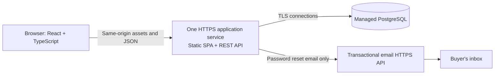

# System Architecture

Project: Eneba-Style Digital Marketplace  
Owner: Daraab Pathania  
Updated: 2026-11-12  
Status: Design draft for review; PRD approved; application implementation not authorized.

## 1. Scope and decision status

This design translates the [approved PRD](PRD.md) into a deployable system for a 2–3 day implementation target. [DATABASE.md](DATABASE.md) follows this architecture and defines the proposed relational model. No scaffold, application source, migrations, infrastructure configuration, or external resources have been created.

**Confirmed product baseline:** 54 mock products (30 games, 15 gaming gift cards, 9 subscriptions); 6–7 stable seller offers per product; working catalog/search, accounts, guest/account carts, simulated checkout, persistent stock consumption, unique simulated keys, buyer-only order history, real-email password recovery, EUR/USD/GBP checkout, backend-driven homepage, same-browser recent history. Decorative cashback is not a balance. No wishlist, seller/admin interface, recurring billing, activation integration, or stock reset.

**Decision labels:** Confirmed = explicit user/assignment requirement. Recommended = proposed engineering choice, not retroactive product approval. Pending = consequential question sent to the author.

| ID | Recommendation | Status / alternative |
| --- | --- | --- |
| AR01 | React + TypeScript SPA, Vite build, client routing; one same-origin application deployment. | React required; same-origin deployment confirmed; TypeScript/build/routing tools recommended. SSR adds little to this evaluator demo. |
| AR02 | PHP + Laravel modular monolith. | Confirmed by author: PHP + Laravel in one modular application with separate homepage content services. Go is an unselected alternative; Laravel reduces account, mail, validation, and transaction integration effort. |
| AR03 | REST JSON over HTTPS under `/api/v1`. | Recommended over GraphQL: predictable resources and less setup for a fixed small UI. |
| AR04 | Managed PostgreSQL, using the same database for transactional data, sessions and shared rate-limit state. | Confirmed: shared managed PostgreSQL on Neon. DB-backed sessions/throttles remain recommended engineering details supporting relational ownership and atomic inventory/orders. SQLite on ephemeral hosting is unsuitable for persistence. |
| AR05 | PostgreSQL substring/trigram search in the application backend. | Confirmed by author: PostgreSQL search. This supersedes the earlier Elasticsearch preference; no separate search service. |
| AR06 | Cookie/session authentication, backend authorization and CSRF protection. | Recommended for same-origin browser UI; no JWT in browser storage. |
| AR07 | One Render free web service, managed Neon PostgreSQL, HTTPS transactional email API. | Confirmed by author: Render + Neon, with the Render service serving React assets and API. Not provisioned or account-verified. |
| AR08 | Real email through an HTTPS provider adapter; Brevo is the provisional recommendation without a verified domain. Resend requires a verified domain for arbitrary recipients. | Author selected Brevo provisionally and has no verified domain. Sender approval and real delivery remain unverified deployment prerequisites, not reasons to assume email is already operational. |

The author has confirmed Laravel and PostgreSQL search. The author also confirmed the modular application and Render + Neon deployment, and provisionally selected Brevo. Other recommended engineering details remain a concrete reviewable baseline rather than a blanket approval of every detail. Framework-specific details below therefore target Laravel. Exact supported versions and lockfiles will be selected when implementation is approved; do not copy an old tutorial's pinned versions automatically.

## 2. Runtime topology



Build React assets and static gallery/banner assets into the application image. The web server serves them and the SPA entry document; `/api/v1/*` and account actions reach the backend. API paths must never fall through to the SPA document. Deep frontend routes return the SPA entry without losing the URL. Serve the build with a production HTTP server, not Vite's development server. If Laravel is chosen, use its normal request lifecycle and a production PHP-serving container.

A single origin avoids cross-site cookie problems and separate frontend/backend releases. Costs: static assets also experience application cold starts and have less independent CDN flexibility. A split static deployment is a future option if caching/performance justify its CORS, cookie and proxy configuration. Keep global search accessible on the checkout layout too, as the assignment says search from anywhere in the app.

Only PostgreSQL and the email provider are external dependencies in the recommended runtime. No Redis, dedicated worker, broker, external search cluster, WebSocket service or object-storage service is required for the initial scope. Avoid inventing microservices to satisfy the homepage wording.

## 3. Backend modules and ownership

| Module | Responsibilities | Persistent data |
| --- | --- | --- |
| Catalog | Product attributes, type/platform/region/genre filters, images, stable sort and pagination. | Products, taxonomy, images, sample reviews. |
| Offers | Seller display data, featured/recommended designation, prices, stock, starting-price aggregation. | Sellers, offers. |
| Homepage | Separate Banner, Navigation, FeaturedProducts, TopGames, GamingCards and RecentlyViewed content services. | Content blocks/collections and shared catalog; history IDs arrive from the browser. |
| Search | Shared matching/ranking contract for suggestions and results. | Product names; optional trigram index. |
| Identity | Registration/login/logout, profile, password change/recovery, sessions and session revocation. | Users, sessions, reset tokens, shared throttle state. |
| Cart | Account cart, canonical offer/quantity validation, guest transfer, versioned mutations. | Carts, lines, transfer receipts. Guest intent initially lives in browser storage. |
| Checkout | Quotes, request replay protection, stock locks, simulated payment result, atomic order/key creation. | Attempts, orders, order items, delivered keys. |
| Orders | Owner-scoped order list/details and key access. | Immutable order snapshots and delivered keys. |
| Currency | Fixed demo rates, deterministic conversion and formatting metadata. | Versioned FX-rate sets. |
| Mail | Provider adapter and bounded reset-email delivery. | Reset-token metadata; no reset-token plaintext in logs. |

Use controllers for input/response, validation objects for accepted fields, application services for business flows, and database models/query builders for persistence. Do not create a generic repository layer for every table without a concrete need. Checkout is an explicit transaction boundary across Cart, Offers and Orders, not independent services exchanging messages.

### Homepage assignment interpretation

Each homepage block calls its own backend content service and reads backend-maintained data. These are separately testable modules/endpoints in the same process, using one relational database. The assignment says each block gets content from its own backend service **or database**; it does not explicitly mandate independent deployments or physical databases. This is the project’s documented interpretation and rationale, explicitly accepted by the author during architecture review.

A backend section manifest supplies section type/order/title/source and content URLs. React owns renderers and fallback layouts, not hardcoded product IDs, category labels, banner copy, or collection ordering. Static UI labels such as Submit are not catalog content. RecentlyViewed accepts only bounded product IDs and hydrates current cards from its backend service. Browser history is not used to personalize Featured products. Fetch blocks independently so a failed optional block does not erase the whole homepage; expose section retry feedback.

## 4. Frontend state and page boundaries

Recommended pages: homepage, catalog/search (shared results view), product detail, cart, protected checkout/payment, confirmation/order detail, order history, registration/login, account/profile/password forms, forgotten-password and reset-link pages.

| State | Authority | Persistence |
| --- | --- | --- |
| Query, categorical filters, price range, sort, page | URL + backend results | Shareable/back-button-safe query parameters. |
| Product/offer/section/FX data | API | Short-lived query cache; refetch on relevant mutations. |
| Guest cart intent | Browser, then backend repricing | Local storage: offer IDs/quantities only, never trusted amounts or keys. |
| Buyer cart | Backend | Account-associated DB cart, refetch on login/focus and conflicts. |
| Country/language/currency preference | Browser | Versioned local preferences; country is cosmetic, English only. |
| Recently viewed | Browser IDs | Bounded local history, deduplicated newest-first; API hydrates cards. |
| Auth identity | Backend session | HttpOnly session cookie; no password/token persistence in local storage. |
| Checkout result and keys | Backend | Owner-authorized query; clear private caches on logout. |

Use URL filters and numbered pages of 12; reset page on query/filter/sort changes. OR within a categorical dimension and AND across dimensions/price. Genres match games only: selecting a genre excludes non-game products; show that behavior clearly. Clear filters leaves query/sort intact. Stable ties use product ID. Sold-out products stay discoverable; their starting price is unavailable and they sort after priced products in either price direction. A price range excludes products with no purchasable offer. These are recommended resolutions of routine PRD details, not extra product features.

Suggested search interaction: start at two trimmed characters, debounce around 250 ms, at most six suggestions, Escape closes and arrow/Enter controls work. Cancel obsolete requests or ignore stale responses. Empty query returns to catalog behavior. Full results default to relevance; explicit sort overrides it. Exact, prefix, substring and typo candidates use deterministic ranking with ID tie-breaks. Name matching only; no synonym/semantic work.

## 5. Search alternatives

Recommended PostgreSQL path: normalize/case-fold names, escape user wildcard characters for literal partial matching, combine case-insensitive exact/prefix/substring matching with `pg_trgm` word similarity for typo candidates. Rank exact matches before fuzzy-only matches. Long titles should be compared by words as well as whole-name similarity. Tune a small documented threshold against the agreed exact/partial/`mincraft` examples and a few unrelated no-match queries; do not promise arbitrary typos or transpositions. Short inputs may rely on prefix matching. PostgreSQL documents trigram similarity and index support; Neon supports the extension. [PostgreSQL pg_trgm](https://www.postgresql.org/docs/current/pgtrgm.html), [Neon extension support](https://neon.com/docs/extensions/pg_trgm).

For 54 products, correctness and understandable ranking matter more than index sophistication. Suggestions and full results use the same match set, then apply filters/sort/pagination before response. Compute counts from the same filtered set. Starting prices always come from current available offers, not a stale index.

Unselected alternative, retained for rationale: Elasticsearch would require the following: PostgreSQL remains source of truth; index only public product/search fields, never keys/accounts/orders. Add a managed search deployment or a separately hosted persistent service, seed/index synchronization and failure/rebuild validation. Retrieve matching product IDs/relevance, then hydrate/filter current availability and pricing in the backend; pagination/count correctness must be specified across the entire candidate set, not just the first result page. Do not run a memory-heavy search node inside the free application container. This adds operational scope for little catalog-scale benefit and is not selected for this release.

## 6. API contract outline

The detailed [API contract](API.md) now specifies paths, schemas, auth/CSRF, errors and replay semantics. This outline is a summary; API.md resolves previously abbreviated route/query details. The dependency-ordered work plan is [TASKS.md](TASKS.md); documentation approval does not authorize implementation.

Proposed contract, not generated code/OpenAPI. Validate and whitelist every sort/filter; bind query parameters through safe database operations. Public UUIDs/slugs do not replace authorization.

| Area | Contract outline |
| --- | --- |
| Bootstrap | `GET /api/v1/bootstrap`: supported currencies/rate version, preference choices, navigation and session identity if needed; no keys. |
| Catalog | `GET /api/v1/products`: q, type/platform/region/genre arrays, min/max price, currency, sort, page; cards + total + page metadata. `GET /products/{slug}`: details, images, sample reviews and related IDs/cards. |
| Offers | `GET /products/{slug}/offers`: available/unavailable seller offers, recommended/featured metadata, selected-currency amounts; no key stock contents. |
| Content | `GET /homepage/sections`, `GET /homepage/sections/{key}`, `GET /products/by-ids` for bounded recent hydration. Responses explicitly mark sample reviews/cashback. |
| Search | `GET /search/suggestions?q=…&currency=…`: small public card list; full search uses catalog query endpoint. |
| Identity | CSRF bootstrap, `POST /auth/register`, `/auth/login`, `/auth/logout`; `GET /me`, `PATCH /me` (display name only), `POST /me/password`. |
| Recovery | `POST /auth/forgot-password`, `POST /auth/reset-password`; generic request result, validate link token/email/new password. |
| Cart | `POST /cart/preview` (public read-only guest pricing); `GET /cart` (buyer); idempotent line quantity replacement via `PUT /cart/items/{offerId}`, `DELETE /cart/items/{offerId}` with expected cart revision; `POST /cart/merge` with transfer ID and complete guest snapshot. |
| Checkout | `POST /checkout/quote`: signed, short-lived quote; `POST /checkout/attempts`: Idempotency-Key header, quote token, payment method, simulate-failure flag. No client-authored totals. |
| Orders | `GET /orders`, `GET /orders/{id}`; owner-only detail/key response. Confirmation reuses order details instead of trusting redirect state. |
| Operations | `GET /health/live`, `GET /health/ready` (DB reachable); no configuration or secret output. |

Authentication required for all account-cart writes, checkout and orders; guest cart pricing reads are public and bounded. Same-origin auth endpoints use framework session/CSRF middleware even if JSON. Mutations return updated cart revision. Use 401 (sign-in), 404 (missing or non-owned order), 409 (stale revision/quote/stock or idempotency payload conflict), 422 (validation), 429 (throttled), 503 (unavailable dependency). A deliberate simulated decline is a normal failed-attempt result, not an internal server error. Include stable error codes and field/affected-offer details; never expose stack traces.

## 7. Cart concurrency and transfer

Recommended local guest cart: persistent random transfer UUID plus a bounded array of offer IDs and positive quantities. Change the snapshot/transfer UUID when guest intent changes. On authentication, retrieve the account cart, then merge the guest snapshot in a backend transaction. Lock the account cart, check a unique `(user, transfer UUID)` receipt, add quantities only once, increment cart revision and record the receipt. Clear guest storage only after acknowledgement; a lost response can safely retry the same snapshot/UUID. Same UUID with changed content is rejected. Preserve stock-shortage quantities after a merge and flag them; do not silently clamp. Invalid/missing offers receive explicit feedback.

Ordinary cart edits use absolute quantities with expected revision. The backend serializes all mutations by locking the cart row; a stale device receives the latest cart and a conflict, not silent last-writer overwrites. Refetch before retrying. Buy now submits an explicit intended new quantity and opens whole-cart checkout, preventing a retry from accidentally incrementing twice. Logout clears authenticated browser caches and opens an empty local guest cart; saved account cart stays in the database. Recent history/preferences remain browser-local. These lifecycle defaults are recommendations for design review.

## 8. Price and currency integrity

Store offer selling prices as EUR integer cents. Keep immutable versioned fixed rates for EUR/USD/GBP; use server-side exact decimal arithmetic and round converted **unit** amounts to nearest target minor unit, half-up. Multiply that rounded unit by quantity, then sum lines. All three selected currencies have two decimal display places. Do not sum unrounded hidden values or use binary floating point for authoritative money. A gift card's face amount/currency is a separate product attribute.

The browser requests a currency and displays returned values. It never supplies authoritative price/rate/total. Quote tokens contain user/cart ID, cart revision, selected currency, FX version, canonical offer/quantity/unit-price snapshot, totals, issue/expiry times and an authenticity signature. Recommended expiry: 10 minutes. Use an authenticated signed token with no keys/secrets inside; any signing secret stays on the server.

At purchase, check price/rate/cart validity against the quote. Stock is always current, not reserved by quoting. If prices or FX version changed, return a new quote for buyer confirmation rather than silently changing the total. Changing currency requires a fresh quote and a new intentional attempt. Completed orders snapshot base and charged unit amounts, rates/version and totals so later settings/catalog changes cannot rewrite purchases. Mock cashback is display metadata and never enters these calculations.

## 9. Atomic checkout and replay protection

```mermaid
sequenceDiagram
    participant UI as Buyer UI
    participant API as Checkout service
    participant DB as PostgreSQL
    UI->>API: Submit signed quote + attempt UUID
    API->>DB: Begin; insert/find unique user/attempt
    API->>DB: Lock attempt, user, cart; replay completed result first
    API->>DB: Verify revision/quote; lock offers in ID order
    alt Stock/quote invalid or simulated decline
        API->>DB: Persist failed/rejected attempt; no stock/order/keys
        API->>DB: Commit
        API-->>UI: Failure details; cart retained
    else Eligible success
        API->>DB: Decrement stock; insert order/items/unique keys
        API->>DB: Clear purchased cart; advance revision; link attempt
        API->>DB: Commit
        API-->>UI: Order identifier
    end
    UI->>API: GET owner-authorized order/keys
```

Use a DB transaction and explicit row locks. PostgreSQL supports row-level `FOR UPDATE` locks; define one lock order and retry bounded deadlocks. [PostgreSQL locking](https://www.postgresql.org/docs/current/explicit-locking.html).

1. Validate authentication/CSRF and bounded input. Resolve the account and a client-generated attempt UUID. Store a canonical request fingerprint including quote, method and simulation flag; a reused UUID with another payload is a conflict.
2. Insert or find the attempt under unique `(user_id, idempotency_key)`, then lock it. If already terminal, return its stored outcome/order reference **before** validating the now-cleared cart/expired quote. Always enforce current authentication and ownership. Concurrent duplicate insertion waits on the unique constraint rather than executing twice.
3. For a new attempt, lock user, cart and affected offers in a documented order. Recheck session-revocation version, cart revision, signed quote expiry/currency/rate, current prices and all requested quantities. All cart writes take the same cart lock. No inventory is reserved by adding to cart.
4. On a stock/quote conflict or explicit simulated decline, persist a terminal failed/rejected attempt, leave cart and stock unchanged, and create no order/keys. Correcting or intentionally retrying a failed purchase uses a **new** attempt UUID; transport retries of the old attempt return the old failure.
5. On success, decrement each offer exactly once, create one order and immutable line snapshots, generate one distinct simulated key per purchased unit, and remove purchased lines/advance cart revision in the same transaction. No external payment or email call occurs inside this transaction.
6. Commit before responding. Unexpected exception/crash rolls back all mutations including any new unfinished attempt. If commit succeeded but response was lost, replay recovers the existing order. Do not store raw key responses in the replay record; return order ID and use the protected order endpoint.

Simulated keys can be generated at purchase rather than preloading an inventory of real secrets. Unique constraints reject collisions; retry generation within a bounded transaction policy. This preserves persistent stock and unique fulfillment without a second stock counter tied to a key pool. No payment-provider ledger or wallet balance is needed. Distinguish simulated declines, stock conflicts and internal failure in logs/UI.

## 10. Identity and recovery

Same-origin secure HttpOnly session cookie, SameSite=Lax, HTTPS and CSRF tokens on state-changing requests. Rotate session ID on login/registration, invalidate on logout, hash passwords through the framework, and scope private queries to current user. Laravel has built-in cookie/session authentication and password recovery services; configure rather than assume their defaults satisfy this PRD. [Laravel authentication](https://laravel.com/docs/13.x/authentication), [Laravel password recovery](https://laravel.com/docs/13.x/passwords).

Use DB-backed sessions plus a user authentication-version value stored in each session. Check it on protected requests. Resetting a password increments that version and removes old sessions atomically; even an in-flight session write cannot restore authorization with the old version. Lock/recheck the user on protected mutations such as checkout to serialize a simultaneous reset. Propose the same global sign-out after an ordinary password change for a consistent small implementation; the user only explicitly required global sign-out for recovery.

Store only a reset-token hash and issuance/expiry information; one active reset row per account. Issuing a newer token invalidates the older one. Serialize concurrent requests by locking the user/reset row. Reset validates token, lifetime and password; atomically consumes token, updates password, revokes sessions. Avoid using remember-me persistence in the initial version. Email-address changes are excluded.

Forgot-password requests produce the same generic confirmation for known/unknown accounts. Throttle by normalized-email hash and IP; also throttle login/registration. Candidate starting limits: reset one request per minute/account and five/hour/IP; tune after deployment testing. Do not reveal account existence via per-account email delivery errors. Log a sanitized provider error/correlation ID privately. Bound provider timeouts and avoid logging token-bearing URLs. Canonical reset links use configured public app URL, not the untrusted Host header; reset pages contain no third-party analytics and use a no-referrer policy.

### Real-email prerequisite

Use an HTTPS email API because the recommended free web host restricts SMTP ports. A synchronous send after token creation is acceptable for low demo volume, with a bounded timeout; no queue worker is deployed. The UI confirmation means a request was accepted, not a guarantee of inbox delivery. Provider failure must be visible operationally and tested; a user can request another link after throttling. No keys or purchase receipts are emailed.

Resend's test domain only delivers to the account owner's address; arbitrary evaluator recovery requires a verified domain. Do not claim the real-email requirement is met by owner-only test delivery. If no domain is available, evaluate an approved sender alternative and obtain the author's choice before changing provider/scope. [Resend sender restriction](https://resend.com/docs/knowledge-base/403-error-resend-dev-domain). Brevo also documents sender/domain verification; availability must be proven for the selected account. [Brevo sender requirements](https://developers.brevo.com/docs/getting-started-with-senders-and-domains).

**No-domain option to validate:** Brevo documents temporarily rewriting unauthenticated/free-email sender addresses to a provider-controlled `brevosend.com` domain. This suggests a viable candidate for real reset emails without buying a domain, but it does not prove this account will be accepted for transactional sending or that evaluator recipients will receive mail. The author provisionally selected Brevo; assess its HTTPS transactional API first, with verified sender-email ownership and an actual delivery check during authorized setup. Do not configure it or send mail during documentation work. If unavailable, present domain-backed sending versus an explicit scope change to the author; never expose reset tokens as a public fallback. [Brevo sender rewriting](https://help.brevo.com/hc/en-us/articles/16045394674066-Troubleshooting-Domain-authentication).

## 11. Deployment recommendation and limitations

One Render free Docker web service serves SPA + backend; external managed PostgreSQL on Neon stores durable data. Choose nearby regions when available, use TLS and conservative connection counts. Persist sessions and throttles in DB, not local files. Build assets into the image; no user uploads in scope. Keep runtime logs sanitized on stdout. GitHub stores source/docs; deploy a pinned revision after explicit implementation/deployment authorization.

Current official docs support Docker for PHP. Render free services sleep after 15 minutes and can take about a minute to wake; their filesystem is ephemeral, common outbound SMTP ports are blocked, and free Render PostgreSQL expires after 30 days. Those constraints motivate external persistent PostgreSQL and HTTPS mail. [Render free-service limits](https://render.com/docs/free), [Render Docker support](https://render.com/docs/docker).

Neon offers a free PostgreSQL plan and documents `pg_trgm`; confirm the chosen region/version, quotas, connection limits, suspension behavior and account eligibility before provisioning. Do not hardcode plan capacities from an older blog post. [Neon plans](https://neon.com/docs/introduction/plans). This is the author-selected free-tier route, not proof that accounts/resources are available.

Migration execution must work without assuming a paid host shell/predeploy job. Recommend a controlled CI/manual release step against the managed database before app promotion, with one migration runner and a lock. Initial demo seeding is a separate deliberate one-time action and never runs destructively on restart/deploy. No stock-reset feature/procedure is added. Store app/session/signing/encryption/email/database secrets only in server environment/secret storage; expose none via Vite public variables or image build arguments. A stable application key must survive redeployment.

## 12. Validation and operational acceptance

- Real PostgreSQL integration tests for stock contention, rollback, duplicate requests, quote validation and unique key assignment. SQLite-only tests cannot prove PostgreSQL locking/search behavior.
- Identity tests for ownership, session revocation, newer reset-token invalidation, expiry and single use. Mail adapters mocked in automated tests; separately verify a real reset email to an authorized test account.
- Catalog/search tests for five filter groups, OR/AND semantics, counts/pages, all sorts/currencies, exact/partial/typo and unrelated no-match examples.
- Cart tests for idempotent guest merge, concurrent device version conflicts, preserved shortages and whole-cart Buy now.
- One browser E2E covering discovery through guest cart/authentication, payment, keys and order history. Manual desktop/mobile, keyboard, loading/error and cold-start checks.
- Readiness checks for DB connectivity, provider configuration and public URL before submission; dependency failures should not disclose credentials or keys.
- Maintain full Markdown prompts/responses and export cutoffs per [history procedure](AI_CONVERSATION_HISTORY.md). Earlier chats/attachments and this turn's final response require final preservation; documentation summaries are not substitutes.

## 13. Trade-offs and review gate

This favors one deployable application and one database over independent services, Redis queues, Elasticsearch and multi-origin auth. Atomic simulated checkout avoids payment webhooks/sagas while still handling meaningful inventory/retry failures. Browser-local history/preferences keep account data small. Snapshot orders preserve explainable price history. Real recovery email is the main external setup risk.

Confirmed architecture decisions: PHP + Laravel, PostgreSQL search, one modular application with separate homepage content services sharing PostgreSQL, and one Render service for React assets/API with Neon persistence. Brevo is provisionally selected for recovery email. Sender approval, provider account availability and successful real delivery must be validated during authorized setup.

Remaining numeric/UI defaults and engineering details are explicit recommendations for consolidated design review, not reasons to reopen approved product scope. DATABASE.md follows the confirmed stack and records proposed constraints. These decisions do not constitute blanket approval of every document detail or authorization to implement. No services have been provisioned and no email has been sent.

### Decision update — 2026-11-12

Author accepted AR02 modular topology/assignment interpretation and AR07 Render + Neon, and provisionally accepted AR08 Brevo. Retained the real-email validation dependency and the application-implementation approval boundary.

- 2026-11-12: Added API.md and TASKS.md links; aligned product-offer slug route and guest-preview contract. No implementation started.
