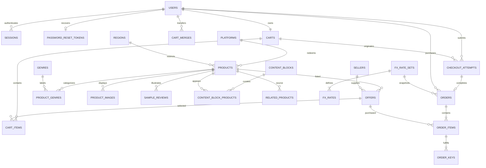

# Database Design

Project: Eneba-Style Digital Marketplace  
Owner: Daraab Pathania  
Updated: 2026-11-12  
Status: Proposed logical/physical design following [ARCHITECTURE.md](ARCHITECTURE.md). PRD approved; no database created and no migrations/SQL implementation authorized.

## 1. Database choice and boundaries

PostgreSQL on Neon is the confirmed transactional database, shared by the modular application; the author confirmed PostgreSQL-based search instead of Elasticsearch. PHP + Laravel is confirmed. Use one managed database with relational constraints and `pg_trgm`; search indexes are derived data in that database. Pin a supported PostgreSQL major version consistently in local/test/deployed environments when implementation is approved. No search cluster, document database, event store, or Redis is needed for this catalog.

Catalog, content, identity, carts and purchases share one database because checkout must atomically consume inventory and create durable orders/keys. Homepage blocks have dedicated backend content services over this database, not one database per block. Browser-local preferences, guest-cart intent and recently viewed IDs are intentionally outside the relational schema.

All table/column names below are design notation, not executable DDL. Exact Laravel migration conventions can be adapted without changing the invariants.

## 2. Conventions

- Domain identifiers: application-generated UUIDs; use UUIDv4 initially for portability. Small taxonomies also use UUIDs with stable unique codes. Laravel session/cache infrastructure may use native string primary keys.
- Timestamps: `timestamptz`, UTC; display in user-facing locale/timezone. Date sorting uses catalog-added time, separately from optional product release date.
- Prices/totals: nonnegative `bigint` minor units, not floating point. Rates: positive `numeric(18,8)`. EUR is the base selling currency; EUR/USD/GBP each use two minor-unit digits.
- Required fields are non-null unless explicitly marked optional. Domain rows have `created_at`; mutable rows also have `updated_at` unless stated otherwise.
- Type/status fields use bounded text plus CHECK constraints, avoiding unbounded strings and database enum migration friction. Treat email as trimmed lowercase for this demo; do not remove dots or plus-tags. Names preserve display spelling.
- Use foreign keys and explicit indexes on frequently joined referencing columns. Unique constraints imply supporting indexes; do not create duplicates. PostgreSQL does not automatically index every foreign-key referencing column.
- Products/offers/sellers are deactivated, not hard-deleted once referenced. Retain immutable order snapshots even if catalog details change. Account deletion is outside scope; no cascade may erase purchase records unexpectedly.
- Never expose database rows wholesale. Public catalog serializers omit identity/security/order data; protected responses verify ownership.

PostgreSQL documents UNIQUE, CHECK and foreign-key constraints and their limitations. Cross-row aggregates require transactions/application validation rather than a CHECK over another table. [PostgreSQL constraints](https://www.postgresql.org/docs/current/ddl-constraints.html).

## 3. Entity relationships

A user gets one reusable cart, created transactionally on registration or first access; the logical exactly-one relationship is enforced by unique user ID plus application creation, not by a foreign key guaranteeing existence. `related_products` has two product references (source and related target). One checkout attempt has zero or one order; failed/rejected attempts have none. Every successful item quantity is fulfilled by that many key rows.

## 4. Catalog and merchandising tables

### products

One row is a purchasable catalog SKU with a specific type, platform, activation region, and applicable denomination/duration. For example, the same game on Steam/Europe and Xbox/United States is two products and counts twice toward 54. Offers under a product vary by seller, price and stock, not by product compatibility. This is a design recommendation that avoids ambiguous comparisons.

| Column | Type / rule |
| --- | --- |
| id | uuid PK |
| slug | varchar(200), unique, stable public URL |
| title | varchar(255) |
| product_type | game / gift_card / subscription |
| platform_id, region_id | uuid FK to platforms/regions; one of each per SKU |
| description | text; plain text/safe formatted content |
| edition | optional varchar(120) |
| publisher | optional varchar(160), display only; no publisher filter |
| gift_face_amount_minor | optional bigint, positive when gift_card |
| gift_face_currency | optional char(3), e.g. EUR/USD/GBP; face value is not selling price |
| subscription_duration_months | optional smallint, positive when subscription |
| popularity_score | integer >= 0, seeded mock metric |
| demo_cashback_percent | optional numeric(5,2), between 0 and 100; display-only |
| catalog_added_at | timestamptz, used for newest/oldest sort |
| release_date | optional date, informational and distinct from catalog_added_at |
| is_active | boolean; inactive products hidden from new discovery/purchase |

Type checks: games have no gift/subscription fields; gift cards require amount+face currency and no duration; subscriptions require duration and no gift fields. If demo subscriptions need a duration not representable in whole months, revise this field explicitly rather than putting unparseable billing semantics into a title. Fixed-duration keys do not create user subscription records. Country preference does not alter region_id.

Recommended indexes: unique slug; B-tree `(is_active, catalog_added_at, id)`, `(is_active, popularity_score, id)`, individual platform/region/type filter indexes as justified by query plans; name trigram expression index described in §10. At 54 products, avoid adding every possible composite filter index.

### platforms, regions, genres, product_genres

| Table | Columns and constraints |
| --- | --- |
| platforms | id uuid PK; code unique varchar(32); name varchar(80); icon_path optional text; display_order integer. Seed Steam, PlayStation, Xbox. |
| regions | id uuid PK; code unique varchar(32); name varchar(80); description text. Seed Global, Europe, United States. These are mock redemption labels, not a country compatibility rules engine. |
| genres | id uuid PK; code unique varchar(64); name varchar(80); display_order integer. Seed a small coherent list suitable for games. |
| product_genres | product_id FK, genre_id FK; composite PK `(product_id, genre_id)`; reverse index `(genre_id, product_id)`. Attach only to games via application validation. |

A game may have multiple genres. OR across selected genres uses an existence predicate/distinct product IDs, not duplicate rows in pagination. Cross-table “only game products get genres” is not a normal CHECK; enforce in the catalog service/seed validation, with no public catalog writes.

### product_images

`id` uuid PK, `product_id` FK, `asset_path` text, `alt_text` varchar(255), `position` nonnegative integer, unique `(product_id, position)`. Position zero is the cover when present. Paths identify immutable bundled assets; URLs are constructed from configured asset origin. No video/upload tables. Product read uses a neutral fallback if an asset is missing; validate seeded assets before deployment.

### sellers

`id` uuid PK; `slug` unique; `display_name`; optional `avatar_path`; `rating_score numeric(4,2)` with range 0–10; `rating_label` optional display text; `is_active` boolean. Ratings are predefined mock data and can be labeled as such. Sellers have no password, login, sessions, wallets or payout accounts. Suggested reusable pool: 8–10 sellers; exact pool size is a data-preparation recommendation.

### offers

| Column | Type / rule |
| --- | --- |
| id | uuid PK |
| product_id, seller_id | uuid FKs, unique pair |
| price_eur_minor | bigint > 0, current base selling unit price |
| compare_at_eur_minor | optional bigint >= current price; visual demo discount |
| stock_quantity | integer >= 0, remaining units |
| is_active | boolean |
| recommended_position | optional smallint > 0, backend merchandising rank |
| is_featured | boolean; at most one per product |

Constraints/indexes: unique `(product_id, seller_id)` enforces distinct sellers; unique partial `(product_id)` where is_featured enforces at most one featured offer; unique partial `(product_id, recommended_position)` where rank not null; index `(product_id, is_active, price_eur_minor, id)` for offers/starting price; index seller_id. Service ensures featured implies recommended and selects only active sellers/products/offers for purchase. A partial unique index cannot require that each product has a featured offer; seed validation handles this.

Recommended seed has 6–7 offers per product and two recommended designations, with one featured. Recommended offers and the repeated featured panel reference the same IDs, not duplicate inventory. Other offers exclude recommended IDs and sort by price; show three then expand. If a designated offer sells out, show it unavailable or select an explicitly defined available fallback without silently changing an already selected cart offer. Stock and all pricing are authoritative only in this table; no separately mutable aggregate stock.

### sample_reviews

`id` uuid PK; `product_id` FK; `display_author`; `rating smallint` 1–5; `body text`; `reviewed_at timestamptz`; `is_sample boolean` fixed true. Index `(product_id, reviewed_at, id)`. No user/order FK: these are read-only fictional samples, not verified buyer submissions. Compute average/count from samples; no review-submission or moderation endpoints. Display sample provenance.

### content_blocks and content_block_products

`content_blocks`: id uuid PK, key unique varchar(64), renderer_type bounded text, title, position, is_enabled, configuration jsonb. Blocks include banner, shortcuts, featured_products, top_games, gaming_cards, recently_viewed, header_navigation and footer. Recently viewed's product selection comes from browser history, not saved collection rows.

Configuration holds bounded presentation content: banner image/alt/text/destination; shortcut label/icon/filter destination; footer groups/links. Validate JSON against the block type and allowlist link schemes/destinations. It must not hold passwords, keys, user IDs, or arbitrary executable templates. No public editing/admin interface.

`content_block_products`: block_id FK, product_id FK, position >= 0; composite PK `(block_id, product_id)`; unique `(block_id, position)`; reverse index product_id. Rows define curated product collections in backend data. Renderer service filters inactive/sold-out recommendations without requiring frontend product lists. Different collections may share products. Banner/navigation use configuration, not artificial product records.

### related_products

`product_id` FK, `related_product_id` FK, `position` >= 0; composite PK on the two IDs; unique `(product_id, position)`; CHECK IDs differ. Reverse index related_product_id. Explicit directional curation; relations need not be symmetric. Return up to five active related products with eligible offers as a recommended UI bound. No recommendation tracking/scoring table.

## 5. Identity and infrastructure tables

### users

`id` uuid PK; `email varchar(254)` unique normalized lowercase; `display_name varchar(80)`; `password_hash varchar(255)`; `auth_version bigint` default 1, positive; created_at/updated_at. Proposed password policy is a configurable minimum length with confirmation and a bounded maximum supported safely by the selected hash algorithm; do not store plaintext. No verified-email prerequisite, roles table, or seller/admin capabilities. The authenticated application role is buyer.

Use framework hashing. The final migration/model may call the column `password` to follow Laravel conventions; it still contains only the hash. Avoid adding `remember_token`/persistent remember-me behavior unless separately scoped. Index/unique normalization must match login, registration and recovery lookup. Ownership FKs point to immutable user IDs, not email.

### sessions

Use the Laravel database-session schema shape: string session ID PK; nullable user_id uuid FK/index; encrypted/session-managed payload text; last_activity integer/index; optional IP and bounded user-agent metadata only if needed. Authentication-version snapshot is in server session payload. Session ID is random and rotates on login; browser receives only the secure session cookie. Session payload must not contain delivered keys or cached passwords.

Match actual framework session driver types/serialization during implementation. An auth-version comparison on protected requests is required in addition to deleting session rows, because a concurrent in-flight request may otherwise save an old session again. A successful recovery increments users.auth_version in the same transaction as token consumption/password update. Recommended idle session limit: two hours, no remember-me; this is a design default for review.

### password_reset_tokens

Use Laravel's standard database-broker physical shape: `email varchar(254)` normalized PK; `token varchar(255)` containing a framework-generated hash; `created_at` timestamp. One row per account email means at most one active reset token. Email editing is excluded, and email is unique in users. Add an FK to users.email only if compatible with the selected framework migration; otherwise the broker/service enforces account existence. Do not introduce a competing user-ID-keyed token table.

Configure expiry to 30 minutes and derive it from created_at; no plaintext token or separate mutable expiry is required. Issuing a new token replaces the old hash. Consumption locks the user (found by normalized email) and reset row, validates hash and lifetime, then deletes the token in the same transaction as password update, auth_version increment and session deletion. All reset writers use the same lock order so concurrent submissions cannot both consume a token successfully. Use the framework broker/hash primitives within that application transaction boundary; do not assume the default controller alone proves concurrency behavior. [Laravel password-reset storage](https://laravel.com/docs/13.x/passwords).

### cache and cache_locks

Laravel database-cache infrastructure for shared rate-limit counters/locks: cache has string key PK, serialized value, integer expiration; cache_locks has string key PK, owner, integer expiration. Use framework migrations/schema when approved. Rate-limit keys include normalized-email digest and IP rather than revealing plain reset tokens. Expiry cleanup may be opportunistic/framework-driven; no dedicated worker required. These are infrastructure tables, not balances or inventory locks.

## 6. Account carts and guest transfer

### carts

`id` uuid PK; `user_id` uuid unique FK; `revision bigint` >= 0; created_at/updated_at. One reusable cart per buyer; successful checkout empties lines and advances revision rather than deleting the cart. Cart rows can exist empty. No persisted guest owner: guest intent is local until merged.

### cart_items

`id` uuid PK; `cart_id` FK; `offer_id` FK; `quantity integer` > 0; created_at/updated_at; unique `(cart_id, offer_id)`; index offer_id. Store offer IDs/quantities only, no authoritative client price or currency. Resolve current prices and seller/product metadata through offers for display/quote.

Do **not** constrain quantity against another row's stock with a CHECK or clamp it after merging: approved behavior preserves a shortage for correction. Ordinary add/edit checks current availability for feedback; checkout revalidates atomically. A reasonable request/item-count/quantity cap protects the API from abuse, but a bound needs to accommodate merged cart intent; document it as an engineering limit and return explicit validation feedback.

### cart_merges

`id` uuid PK; `user_id` FK; `cart_id` FK; `transfer_id` uuid; `payload_hash char(64)`; `applied_revision bigint`; `merged_at`; unique `(user_id, transfer_id)`; index cart_id. Transfer payload fingerprint is canonical offer/quantity data. Same transfer ID + same hash returns existing acknowledgement; a changed payload with that ID conflicts. Lock cart before applying lines and writing receipt. Never sum quantities again merely because the browser missed the acknowledgement.

Receipts contain no guest prices/secrets. Check cart belongs to the same user (application check); one cart/user and no reassignment keep this stable. Local storage is cleared only after successful acknowledgement. Ordinary cart writes require expected revision; stale devices refetch and explicitly retry, not overwrite another device's changes.

## 7. Currency data

### fx_rate_sets

`id` uuid PK; `version varchar(40)` unique; `base_currency char(3)` CHECK EUR; `effective_at`; `created_at`. Treat rate sets as immutable once referenced. Select newest effective set; avoid mutable `is_current` flags competing across rows. Distinct effective_at/version order gives deterministic selection.

### fx_rates

`rate_set_id` FK; `currency char(3)` CHECK EUR/USD/GBP; `rate numeric(18,8)` > 0; composite PK `(rate_set_id, currency)`. EUR rate must equal 1. Application validation ensures exactly those three rates exist before a set becomes eligible. `orders(rate_set_id, currency)` uses a composite FK to this pair so every order references a valid rate/currency combination.

Proposed illustrative first set: EUR=1.00000000, USD=1.10000000, GBP=0.85000000. These are invented demo values, not current market exchange rates. Proposed default: EUR, Lithuania, English; preferred countries Lithuania/United States/United Kingdom. Preferences live in the browser, not users. These defaults remain design recommendations.

Convert base unit cents with exact decimal rate and round half-up to a target minor unit. Line total = rounded charged unit × quantity. Order total = sum of line totals; no service fee. Store snapshot amounts even though rate data is immutable, so order retrieval never reruns conversion. Price filtering uses the displayed converted minimum eligible-offer unit price, with consistent inclusive bounds.

## 8. Purchase and fulfillment tables

### checkout_attempts

| Column | Type / constraint |
| --- | --- |
| id | uuid PK |
| user_id, cart_id | uuid FKs |
| idempotency_key | uuid; unique with user_id |
| request_hash | char(64), canonical fingerprint |
| cart_revision | bigint >= 0, quote's revision |
| quote_fingerprint | char(64), integrity/audit reference; no raw key data |
| currency | char(3) CHECK EUR/USD/GBP |
| payment_method | card / paypal / digital_wallet |
| simulate_failure | boolean |
| status | processing / succeeded / declined / rejected |
| result_code | optional bounded error/result code |
| result_http_status | optional smallint valid HTTP result |
| result_payload | optional jsonb, sanitized outcome/affected offer IDs, never keys or secrets |
| completed_at | optional timestamptz; required for terminal states |

Index `(user_id, created_at, id)` for bounded diagnostic lookup; cart_id index. Nonterminal processing row exists inside its transaction; normal code commits only terminal outcomes. An unexpected exception rolls it back. A newly inserted attempt is locked before any inventory changes. If a response was lost after commit, a retry finds terminal result without rerunning quote validation on an emptied cart.

A deliberate failed payment uses declined; stock/stale-cart/quote failure uses rejected; both create no order and consume no stock. Changing the payload with a reused idempotency key returns 409. Intentionally retrying after fixing a problem uses a new key. Retain receipts for the demo lifetime; do not expire successful idempotency records while their orders remain.

### orders

| Column | Type / constraint |
| --- | --- |
| id | uuid PK; public owner-scoped route ID |
| order_number | varchar(40), unique human-readable reference |
| checkout_attempt_id | uuid unique FK; at most one order per attempt |
| user_id | uuid FK |
| buyer_email_snapshot | varchar(254) |
| status | completed only in initial scope |
| payment_method | card / paypal / digital_wallet, snapshot |
| currency | char(3), charged/order currency |
| rate_set_id | uuid FK; with currency also FK to fx_rates |
| exchange_rate_snapshot | numeric(18,8) > 0 |
| subtotal_minor, total_minor | bigint >= 0; CHECK equal because no fee |
| base_total_eur_minor | bigint >= 0, audit sum of base unit × qty |
| purchased_at | timestamptz |

Index `(user_id, purchased_at DESC, id)` for newest-first owner history. No separate payments table: payment is simulated and the attempt stores its outcome/method. Failed attempts do not appear as completed orders; adding pending/cancelled/refunded orders would be new product scope. The service enforces attempt.user_id = order.user_id and succeeded status in the same transaction; foreign keys alone do not enforce those cross-row comparisons.

### order_items

`id` uuid PK; `order_id` FK; `offer_id` FK; `product_id` FK; `seller_id` FK; `quantity integer` > 0; `product_title_snapshot`, `product_slug_snapshot`, `image_path_snapshot` optional, `product_type_snapshot`, `platform_snapshot`, `region_snapshot`, `seller_name_snapshot`; `gift_face_amount_snapshot`/`gift_face_currency_snapshot` optional; `subscription_duration_months_snapshot` optional; `base_unit_eur_minor bigint` > 0; `charged_unit_minor bigint` >= 0; `line_total_minor bigint` >= 0; unique `(order_id, offer_id)`; indexes product_id/seller_id/offer_id.

CHECK line_total_minor = charged_unit_minor × quantity with bounded inputs preventing integer overflow. Item currency inherits order currency; do not add a second mutable currency per line. Snapshot the product's type-specific attributes when relevant. Product/offer/seller links must refer to a consistent tuple; validate under locked offer read in the checkout service. Historical rendering uses snapshots, not mutable catalog joins. Never recalculate historical prices or use gift-card face value as paid price.

### order_keys

`id` uuid PK; `order_item_id` FK; `unit_number integer` > 0; `key_ciphertext text`; `key_digest char(64)` unique; `created_at`; unique `(order_item_id, unit_number)`. Index through the unique item/unit key supports ordered key lookup. Keys generated for purchase are explicit simulated non-activatable strings; encrypt at rest using stable server-held application encryption material, and use SHA-256 of the high-entropy key for global uniqueness. Never expose key_digest as the activation key.

For quantity N, create N rows numbered 1..N in the purchase transaction. Application validation ensures count = N and unit_number <= item.quantity; these are cross-row invariants, not standalone CHECK constraints. No nullable key-reservation owner, reusable key pool, or second mutable stock count. A key belongs to one immutable order item; no update/reassignment endpoint.

Owner authorization follows order_keys → order_items → orders.user_id. No public product, offer, cart, content, search or health response includes keys. Owner history summaries return metadata; full key material is returned only by private detail routes with `Cache-Control: no-store`. Do not record decrypted keys in application logs, replay receipts or analytics.

## 9. Transaction and lock rules

Recommended isolation: PostgreSQL READ COMMITTED with explicit locks and constraints. Use identical lock order in all writers: attempt (checkout only), user, cart, then offers sorted by ID; recovery locks user then reset/session state, and all ordinary account-cart writers lock user/cart consistently. Never keep DB locks while calling the external email provider. Row locks are held until transaction end; unique constraints arbitrate concurrent duplicate insertion. [PostgreSQL explicit locking](https://www.postgresql.org/docs/current/explicit-locking.html).

### Successful checkout

1. Insert/find unique attempt and lock it. Return terminal replay immediately after authentication/ownership checks; compare payload fingerprints.
2. Lock user and verify current session auth_version; lock the user's cart and verify quote revision/ownership. Lock offers in stable ID order. Validate signed quote and current price/rate, product/seller activity, all quantities and remaining stock.
3. If any line fails, record rejected terminal attempt only; no order, stock decrement, partial cart removal or keys. If simulated failure selected, record declined only.
4. Otherwise decrement locked stock, insert completed order and snapshot lines, generate/insert one unique key per unit, clear purchased cart lines and increment revision, mark attempt succeeded with order-reference result. Do all of this in one transaction.
5. Commit; fetch owner-scoped order details separately. Any unexpected error rolls back all changes; a retry may safely execute if no commit occurred. A committed result is never repeated as a new purchase under the same key.

### Concurrent last-stock purchases

Different carts/attempts serialize on the same offer row. After the first commit, the second sees reduced stock and must reject the whole purchase if insufficient. Stock CHECK prevents negative values as a final guard but does not replace locking. All other offered quantities remain untouched on failure. There are no reservations or stock-expiry jobs.

### Recovery and cart transfer

Recovery uses user/reset locks, compares the hashed token under those locks, validates the 30-minute lifetime, updates password, increments auth_version, removes sessions and consumes token atomically. A newer issued token replaces the prior hash; concurrent consumption can succeed only once. Real email is sent after token issuance commits, with generic public confirmation; a delivery failure does not expose the account or raw token.

Guest transfer locks the user/cart and checks transfer receipt before addition; lost-response retries do not add twice. Revision-protected edits and checkout all lock the same cart, so newly added items cannot be erased by a checkout operating on an older quoted revision.

## 10. Query and index design

Compute a product's starting price from the minimum price of active, in-stock offers from active sellers for an active product. Keep it derived at this scale; do not persist a stale products.starting_price column or maintain a cache invalidation pipeline. Query offer aggregation once and join by product ID to avoid N+1 API reads. Convert to requested currency consistently for display/filtering.

Use existence predicates for multi-genre selections and distinct product IDs before count/page. Sort IDs deterministically after any score/price/title/date expression. Page size is fixed at 12 with bounded page inputs. Price-null products sort last in both directions; explicit price ranges exclude nulls. The total count derives from the same filters/search set as returned cards.

Enable `pg_trgm` and propose GIN on the normalized lowercase product title expression using trigram operator class. Exact/prefix/substring match and word similarity form relevance tiers. This is derived from the title, not a second mutable product list. For very short queries indexes may be less useful; 54 products remain cheap to scan. Parameterize queries and escape literal `%`/`_` input. Index usage and similarity thresholds need testing with accepted query examples; do not assert that a generic index automatically guarantees the intended typo ranking. [PostgreSQL pg_trgm](https://www.postgresql.org/docs/current/pgtrgm.html).

Additional indexes should be driven by representative query plans: owner-order history; cart lines by cart; content/related collections by position; token lookup; session user/expiry; offer product/price. Avoid a separate search history, user-view activity table, recommendation events, wishlist, ledger, subscription schedules, or stock-reset records: all are outside the selected scope.

## 11. Initial data and non-destructive evolution

- Exactly 54 product rows: 30 games, 15 cards, 9 subscriptions across the three platforms/regions. Do not force every type/platform combination (for example, a subscription for every platform) merely to fill a grid.
- Assign 6–7 distinct-seller offers per product (324–378 total) from a reusable mock seller pool. Use deterministic randomness with a fixed seed in data preparation so review/tests can reproduce it; never rerandomize at read time or redeploy.
- Propose initial stock 10–30 units per offer to support evaluation without a reset feature. Persist actual reductions. Initial seed is deliberate one-time setup, not an operational replenishment/reset command.
- Seed genres, static image paths, sample reviews, product relations, section content and one illustrative FX-rate set. Keep recommendation/offer-feature choices in backend data.
- Validate total counts, offer counts/distinct sellers, SKU attributes, featured uniqueness, eligible content links, image existence and nonnegative stock. Do not invent real external trust or purchase provenance for samples.
- Migrations evolve schema only; seed runs never drop/truncate orders, users, attempts, keys or depleted inventory. Existing referenced rows are not overwritten automatically with initial stock. Separate test fixtures from deployed demo data.
- No migrations are authored/applied in this design task. When implementation is approved, run migrations once through a controlled release step against the managed database; do not assume a free hosting shell or use destructive seeding on application boot.

## 12. Validation matrix and integrity limits

| Invariant | DB guarantee | Service/test responsibility |
| --- | --- | --- |
| Distinct seller offers per product | Unique product/seller | Seed 6–7 offers/product; count validation. |
| One buyer cart | Unique carts.user_id | Create-once behavior; cart/user lock discipline. |
| Same guest transfer once | Unique user/transfer | Canonical hash; receipt and line writes in one transaction. |
| Nonnegative stock | CHECK stock >= 0 | Locks/current-stock validation across all items. |
| One order per attempt | Unique orders.checkout_attempt_id | Fingerprint replay, terminal-state handling, user consistency. |
| No duplicate delivered key | Unique key_digest, item/unit | Distinct simulated-key generation; exactly quantity keys. |
| Correct order amounts | Nonnegative and line arithmetic checks | Exact FX/rounding, sum totals and immutable snapshots. |
| Only buyer sees keys | FKs preserve relation | Auth-scoped queries; negative ownership tests. |
| Latest reset link, single use | One token row/account | Framework broker plus user lock, expiry/consume transaction. |
| Reset revokes sessions | Persisted auth_version | Version middleware, session deletion, concurrent reset/checkout tests. |
| Read-only reviews / no real cashback | No write paths/ledger tables | Serializers and UI identify samples; no fake purchase success. |

Integration tests must use PostgreSQL for constraints, pg_trgm and locks. Add failure-injection tests before/after order/stock/key writes to verify rollback. Send repeated identical attempts and simultaneous last-stock attempts to prove behavior; a disabled frontend button is not sufficient evidence. Restore no deployed inventory as part of validation; run destructive fixtures only against an isolated test database.

## 13. Review status and remaining design defaults

Laravel and PostgreSQL search are confirmed by the author. This database design remains a reviewable proposal, not approved migrations. Confirmed deployment is one Render application service plus Neon PostgreSQL. Brevo is provisionally selected for real recovery email. Outstanding dependency: no verified sender domain; provider acceptance, sender verification/provider-domain support, and actual delivery still require validation during authorized setup. This does not require storing email API credentials in the database.

Recommended defaults needing consolidated design review: one platform/region per product SKU, 8–10 reusable sellers, 10–30 initial offer stock, static two-recommended/one-featured designation, local history/display bounds, fixed FX values/default country choices, exact quote/session lifetime and password policy. These are implementation-level refinements, not replacements for approved product requirements. The reset-token shape follows Laravel’s standard email-keyed broker table; verify its migration types against the selected framework version before authoring migrations.

Decision update (2026-11-12): modular shared-database architecture and Render + Neon confirmed; Brevo provisional. No schema applied, external services configured, or implementation started.

API/task cross-reference (2026-11-12): [API.md](API.md) serializes bigint money/revisions as integer strings, resolves the public guest preview without a guest DB table, and defines the same attempt/merge replay invariants. [TASKS.md](TASKS.md) sequences schema work after explicit implementation approval. No schema change is implied by these contracts.
