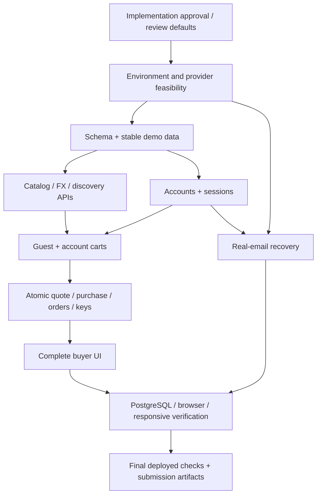

# Implementation Plan

Project: Eneba-Style Digital Marketplace  
Owner: Daraab Pathania  
Updated: 2026-11-12  
Status: Proposed plan. **No implementation has started or been authorized.** All implementation tasks below are unchecked.

## 1. Inputs, approval boundary and delivery target

Inputs: [approved PRD](PRD.md), [assignment coverage review](PRD_COMPLIANCE_REVIEW.md), [architecture](ARCHITECTURE.md), [database design](DATABASE.md), and [API contract](API.md). PHP + Laravel, PostgreSQL search, one modular application, Render + Neon and provisional Brevo are selected. Remaining document defaults are proposals until reviewed; do not silently treat them as earlier user decisions.

This plan defines work to perform **after explicit implementation approval**. Writing TASKS.md does not authorize scaffolding, dependency installation, migrations, external account setup, email sends, deployment, GitHub publication or submission. When those stages are authorized, complete the reversible preparation before asking for any required final publication/action approval. No extra product features are implied by a visible reference-site control.

The author received the assignment Monday 9 November 2026 at 14:30. Provisional seven-day cutoff: Monday 16 November at 14:30 Europe/Vilnius, assuming that receipt timezone and no differing email instruction. Preferred delivery target: 14–15 November, using roughly 2–3 days from planning. Exact remaining working hours are not supplied. Estimates below are focused engineering hours, not calendar promises; they include normal implementation validation but not prolonged provider approvals or a major scope change.

Recommendation: plan for three intensive working days, with a working vertical slice by the first day and substantial release-verification time on the last. Two days is high risk with 54 content records, stock/idempotency rules, responsive styling and real email. Do not spend the evaluation buffer on extra features.

## 2. Milestones and dependencies

This is a dependency graph, not an instruction to spawn agents or parallelize work across people. Frontend shell and server work can be interleaved by the same developer. Integrate slices against real API data early; do not build every screen against hardcoded product lists then postpone the backend.

| Milestone | Exit evidence |
| --- | --- |
| M0 — Ready | Approved implementation scope; reproducible environment; database/hosting/email feasibility known. |
| M1 — Working purchase slice | A real backend product/offer can be added as guest, merged after sign-in, purchased with simulated success, and viewed as an owner-only key/order. |
| M2 — Full agreed scope | All catalog/search/homepage, currency, media, reviews/related/history, account/recovery and edge-case behavior integrated. |
| M3 — Submission ready | Deployed buyer journey works; meaningful tests pass; responsive/keyboard checks complete; source/setup docs/full Markdown history and public URL ready. |

## 3. Dependency-ordered task register

Every task needs the implementation approval gate even where the dependency column abbreviates it. Estimates are planning ranges; revise after environment/provider checks. “Evidence” is what a reviewer can inspect, not a checkbox based on generated files alone.

| ID | Task / expected output | Depends on | Focused hours | Completion evidence |
| --- | --- | --- | --- | --- |
| T00 | Review API/design defaults and obtain explicit implementation approval. Record accepted versions/defaults without reopening confirmed product scope. | — | 0.5–1 | Approval recorded; unresolved prerequisites named. |
| T01 | Establish Laravel/React/TypeScript toolchain, PostgreSQL test environment, repository structure, secrets examples and same-origin production build approach. | T00 | 1–2 | Clean install/build; frontend deep route and API JSON route are distinguishable. |
| T02 | Validate Render/Neon and Brevo feasibility through authorized setup. Confirm TLS DB, pg_trgm, sender/API sending permission, and a real reset-style email to an authorized inbox. Keep deployment probe minimal. | T01 | 1–2 | Durable DB connectivity, available free-tier route, verified email receipt or an explicit blocker with alternatives. |
| T03 | Implement schema/migrations and deterministic one-time demo data; validate catalog, offers, assets, content and FX. | T01, DB portion of T02 | 2–3 | Real PostgreSQL migrations; exactly 30/15/9 products, 6–7 distinct offers each; stable data after restart; no destructive boot seeding. |
| T04 | Build same-origin React shell, shared header/search placement, navigation/footer, design tokens, routes and reusable cards/forms/states. | T01 | 1.5–2.5 | Eneba-inspired responsive shell; no hardcoded homepage product content. |
| T05 | Implement FX/money helpers, bootstrap, catalog/detail/offers, related/sample-review read APIs and query semantics. | T03 | 2–3 | Correct converted unit/line amounts, five filter groups, seven sorts, page/count agreement and public serializers with no keys. |
| T06 | Implement registration/login/logout/profile/password change, DB sessions/CSRF/auth_version and backend ownership boundaries. | T03 | 1.5–2.5 | Session rotates; unauthenticated/other-buyer access rejected; display-name-only edits; session revocation tested. |
| T07 | Implement public guest preview, local guest intent, revisioned account cart, idempotent guest transfer and whole-cart Buy now. | T05, T06 | 2–3 | Guest reload persistence, cross-device buyer cart, one merge despite replay, stale-device conflict and shortage preservation. |
| T08 | Implement signed quotes, atomic simulated purchase, idempotency receipts, stock locks, order snapshots and per-unit unique keys. | T07 | 2.5–4 | Success/decline/stock conflict/rollback/replay behavior proven on PostgreSQL; no negative stock, duplicate orders or repeated keys. |
| T09 | Connect cart/payment/confirmation/history UI to the real endpoints. Show all three simulated payment choices and deliberate failure control. | T04, T08 | 1.5–2.5 | Complete M1 purchase slice including sign-out/in key retrieval and copy controls. |
| T10 | Add PostgreSQL name search/ranking and live suggestions with full results, keyboard controls, debounce and stale-response protection. | T05, T04 | 1.5–2.5 | Exact/partial/mincraft examples and no-match pass; explicit sorting overrides relevance. |
| T11 | Implement independent backend-driven homepage sections, curated collections, browser-local Recently viewed and settings modal. | T04, T05 | 1.5–2.5 | Content edits reflected from backend, per-section failure isolation, no recommendation tracking, EUR/USD/GBP consistent through cart/checkout. |
| T12 | Complete product page reference styling: static gallery, featured panel, recommended/other offers, Load more, sample reviews, related cards and visual-only cashback. | T04, T05, T07 | 1.5–2.5 | 6–7 real demo offers; selected seller preserved; no working wishlist/real cashback/trailer integration. |
| T13 | Complete real-email password recovery and forms; newest-link-only, expiry/single use, generic confirmation and all-session revocation. | T02 email viability, T06 | 1–2 | Authorized inbox receives link; reset works once within 30 minutes; old/expired tokens and old sessions fail. |
| T14 | Consolidate critical PostgreSQL integration/negative/concurrency tests and one browser E2E; fix found defects. Tests for a slice are developed with that slice, not deferred until here. | T08–T13 | 2–3 | Critical checks and one automated end-to-end purchase pass against isolated data; no known critical defects. |
| T15 | Responsive and keyboard QA, loading/empty/error/retry states, safe logging/cache review and asset polish. | T09–T13 | 1.5–2.5 | Core journey usable at representative desktop/mobile widths, no unintended overflow, labeled/focusable controls and safe errors. |
| T16 | Final release deployment, controlled migrations/one-time seed, cold-start/persistence/private-route/real-email smoke checks. | T02, T14, T15 | 1–2 | Public HTTPS app with working DB and buyer journey; restart preserves accounts/orders/stock. |
| T17 | README/run/test/known-limit docs, assignment walkthrough, full Markdown conversation export verification and reviewable submission bundle. | T16 | 1–2 | GitHub link, public URL, actual complete prompt/response Markdown, setup instructions and limitations verified; no secrets. |

- [ ] T00 — approval/defaults recorded.
- [ ] T01 — reproducible toolchain and same-origin skeleton.
- [ ] T02 — authorized provider feasibility checks.
- [ ] T03 — migrations and validated stable demo data.
- [ ] T04 — shared shell/components.
- [ ] T05 — FX/catalog/product APIs.
- [ ] T06 — accounts/session/CSRF/ownership.
- [ ] T07 — guest/account carts and merge.
- [ ] T08 — transactional checkout/orders/keys.
- [ ] T09 — complete purchase UI.
- [ ] T10 — search and live suggestions.
- [ ] T11 — homepage/history/settings.
- [ ] T12 — product reference styling.
- [ ] T13 — real recovery email and lifecycle.
- [ ] T14 — integration/concurrency/E2E evidence.
- [ ] T15 — responsive/keyboard/states/security QA.
- [ ] T16 — deployed release checks.
- [ ] T17 — documentation/history/submission artifacts.

Track status as not started / active / blocked / complete once work is authorized. Add brief evidence links or test summaries to the completed task; avoid declaring it complete from source generation alone. No task is complete in this document's initial version.

## 4. Proposed three-day working sequence

Use effort blocks rather than promising dates while daily hours are unknown. Tasks can be interleaved; the full estimate is not compressed by labeling work “Day 1.”

- **First block:** T00–T03, shell essentials, a minimal backend product/offer read, auth, guest/account cart, then checkout/order/key slice. Expose email/provider blockers here. M1 is the priority over full styling. If M1 cannot be demonstrated in the first intensive workday, revise the delivery estimate before adding polish.
- **Middle block:** Finish the complete catalog and search contract, homepage backend sections/history, settings/currency, product detail presentation, account profile/password recovery. Keep testing each completed slice. Reach M2.
- **Final block:** Finish negative/concurrency and one E2E validation, responsive/keyboard QA, release deployment and real-email verification, README/artifact export and final assignment walkthrough. Reserve at least 4–6 focused hours for these release tasks; do not leave them until the last hour.

The task ranges sum to **26.5–44.5 focused hours**. Allow roughly **3–5 additional hours of contingency**, giving a planning range of **29.5–49.5 hours**. At three days, even the task-only range averages 8.8–14.8 focused hours/day. This is an intensive target rather than a comfortable guarantee. These ranges exclude unpredictable sender approval, DNS/account delays, host outages, major design changes or unfamiliar-tool troubleshooting. If available hours are lower, ask the author to adjust scope or the target; do not silently drop approved recovery, multi-currency, stock integrity or submission history.

## 5. Task details and important implementation decisions

### Setup, hosting and initial data

Select supported Laravel/PHP, React/TypeScript/Vite, PostgreSQL and test-tool versions; document/pin them during implementation. Do not generate application code as part of this plan. Keep local/test/deployed behavior close enough to prove pg_trgm and row locks; SQLite-only tests are insufficient.

One Render service serves SPA/assets and API; Neon stores all durable state, including sessions/shared throttle counters. Persist application encryption/signing secrets across deploys. Bundle static assets rather than writing uploads to the free host's ephemeral disk. Migration runner is controlled/serialized and does not assume a paid platform shell. Use a separate deliberate initial seed, never a destructive seed/replenishment on app start or redeploy. No stock-reset feature is scheduled.

Brevo setup must prove actual approved sender/API recipient delivery, not just return a mock success. The author has no verified domain. If that route fails, present a concrete domain-backed provider alternative or an explicit product-scope change for the author's decision. Do not buy a domain, change the PRD, or expose recovery links publicly without authorization.

Prepare the 54 products through structured demo data and a reusable seller pool; one-time deterministic randomization, coherent denomination/duration fields and valid image paths. Mock real-world accuracy is permitted; platform behavior and internal consistency are mandatory. Label reviews/cashback as samples. Do not force nonexistent type/platform combinations just to make counts symmetric.

### Buyer-journey critical path

Catalog price, cart preview, quote and final order use the same currency/money helper. Unit conversion/rounding comes first; line totals are unit × quantity. Backend computes everything and snapshots the completed purchase. Gift-card face value is separate from selling price. No service fees or payable cashback.

Guest cart transfer is explicit after login/registration; it adds quantities once using a transfer UUID/receipt, preserves shortages, and clears local intent only after acknowledgement. Buyer cart updates use expected revisions; Buy now uses the same whole-cart path. Password/session reset cannot leak buyer cart/keys into a guest view.

Checkout creates one terminal attempt result per user/idempotency key; success consumes stock, creates order/items/distinct simulated keys and clears the cart in one transaction. Replaying the same request returns that result even if the quote later expires or cart is empty. Failure leaves stock/cart unchanged, with no order/keys; a deliberate new attempt gets a new key. No real payment SDK, webhooks, external activation or recurrent subscription code.

### Frontend quality and reference fidelity

Use inspected Eneba layouts for routine presentation: purple sections, cards, filter sidebar, prominent search, featured seller panel/rows, cart drawer/summary and checkout progression. Keep search accessible on the checkout layout too. The exact required behavior comes from PRD/API, not every visible real-site affordance.

Static gallery, curated related cards, read-only sample reviews and browser-local Recently viewed are included. Cashback may be visual-only; wishlist stays excluded. Unsupported secondary controls must be visibly unavailable/demo rather than claiming a successful operation. Do not clone external trust or refund guarantees as real properties of the demo.

Proposed manual widths: 390px mobile and 1440px desktop, with an intermediate tablet check. Keyboard paths include search suggestions, gallery, filter forms, cart, authentication, payment and key copying. Loading/empty/error and cold-start behavior are part of working UX, not expendable animation polish.

## 6. Meaningful validation and release gates

| Check | Evidence required | Tasks |
| --- | --- | --- |
| Catalog/content | Counts 54 and 30/15/9; 6–7 distinct offers; stable seed; all cards/assets/content from backend; five-filter OR/AND semantics and page totals. | T03, T05, T10–T12 |
| Search | Exact/partial/basic typo/no-match; shared candidate logic; relevance default and explicit-sort precedence; stale response not overwriting newer query. | T10, T14 |
| Money | EUR/USD/GBP unit-rounding/line totals, inclusive price filters, no fee, immutable historical currency/amounts, separate face values. | T05, T08–T09, T14 |
| Accounts | Rotation, CSRF, ownership, display-name-only edits, password current verification, reset expiry/newest/single-use and all-session revocation. | T06, T13–T14 |
| Cart | Guest reload, cross-device buyer retrieval, lost merge response replay, duplicate offer quantities, stale-device conflict, shortages retained, whole-cart Buy now. | T07, T09, T14 |
| Purchase integrity | Simulated success/decline; one insufficient item blocks all; concurrent last-stock requests; no negative stock; rollback; no duplicate order or keys on replay/timeouts. | T08, T14 |
| Key access | Quantity N yields N distinct keys; confirmation/history retrieve same keys; another buyer/guest cannot access; no public API/log/cache leakage. | T08–T09, T14–T15 |
| Complete journey | One automated guest discovery → cart → auth/merge → payment → keys/history scenario, plus manual mobile journey. | T14–T15 |
| Recovery email | Authorized inbox actually receives a working link in deployment; provider prerequisite not merely mocked. | T02, T13, T16 |
| Persistence/release | HTTPS public app, cold-start behavior, safe deep links, DB-backed state survives restart, stable app secrets; no destructive reseed. | T16 |
| Submission | Accessible source link, deployment URL, README/trade-offs, actual full Markdown prompts/responses and attachment/session inventory. | T17 |

Backend business-rule checks are developed with the relevant feature. T14 consolidates coverage and fixes failures; it is not permission to defer all testing. Use isolated test data for destructive/concurrency cases; do not reset or drain deployed demo inventory as an automated test fixture. After checks pass, repeat only when changes or unresolved failures justify it.

## 7. Scope guardrails and contingency

**Never silently cut:** assignment catalog/homepage/search/detail/auth/checkout/key delivery; selected real-email recovery; buyer-only data; cart merge and persistence; stock/idempotency; fixed-rate currency; responsive usable core flow; public deployment/GitHub/full Markdown conversation deliverables.

**Reduce polish first:** gallery asset count (keep static gallery), animation/micro-interactions, decorative footer depth, simulated brand art detail, nonessential tooltip styling, number of sample review entries and elaborate cashback presentation. Preserve selected components and honest unavailable/demo states. Do not describe a visual mock as completion of a required working feature.

**Ask for a scope decision if blocked:** Brevo cannot send to real recipients; free host/database not usable; approved work exceeds usable hours; a framework requirement conflicts with the documented session/recovery design. Present the failing evidence, concrete alternatives and impact. No speculative new features are scheduled.

**Explicitly out of scope:** stock reset/replenishment feature, admin/seller dashboards, actual payment integration, real digital-key activation, wallet balances, recurring billing, review submissions, wishlist storage, personalized recommendations, Elasticsearch, localization, trailers, refunds/disputes, extra product types and real cashback accounting.

## 8. Conversation preservation and submission sequence

Full prompts **and** responses are a mandatory deliverable. Follow [AI_CONVERSATION_HISTORY.md](AI_CONVERSATION_HISTORY.md); export at working-session boundaries and after the final substantive response. Preserve raw project-session sources privately, validate role/order/exact text counts, keep timestamp/hash manifests, and inventory earlier sessions and attachments. Do not replace full transcripts with this task plan, a summary, Git commit messages or a share link.

Initial/working snapshot existence does not prove completeness. T17 must identify all project chats, refresh this thread after its final response, verify first/last messages and retain actual Markdown files in the submission. If a credential must be redacted, document the redaction; do not silently rewrite dialogue. Do not expose internal platform instructions/hidden reasoning as user-visible conversation.

Prepare the concrete submission bundle first: GitHub link(s), public URL, Markdown history, README/setup/tests/known limits and a short evaluator walkthrough. Verify link access and that setup instructions match the delivered revision. Sending the reply to the registration email is a separate external action; it is not authorized by this documentation request. Mark submission complete only after the authorized handoff/action is actually done.

## 9. Review checklist and estimate

- [ ] Author has reviewed the API/implementation plan and explicitly authorized implementation.
- [ ] Remaining design defaults are recorded as accepted or revised: exact version pins, REST/session handshake, FX/default settings, initial stock/seller pool, quote/session lifetimes/password bounds, display limits and lifecycle conflict feedback.
- [ ] Hosting/email prerequisites have an authorized verification route; no credentials requested in chat.
- [ ] Actual usable hours are compared with the estimate; release validation/documentation time retained.
- [ ] Scope changes, if any, are explicit and reflected in PRD/API/database/task dependencies.

All checkboxes are pending. Approval of these documents alone does not start implementation unless the author explicitly authorizes it.

Estimate check: 18 task rows; 26.5–44.5 focused hours before 3–5 hours contingency. All implementation task checkboxes remain unchecked.
